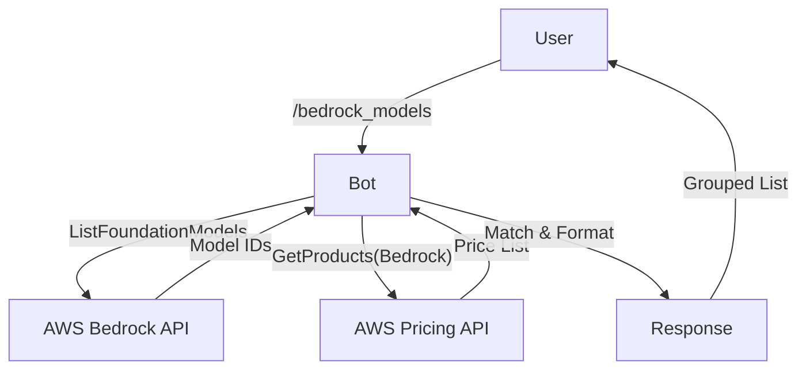

# Requirements

### Overview & Goals
The goal is to provide users with a quick way to check available Amazon Bedrock models and their current on-demand pricing directly via the Telegram bot, using a rich markdown format. This helps in making informed decisions about which models to use based on their cost.

### Scope
- **In Scope**:
    - Fetching active foundation models in the configured AWS region.
    - Fetching on-demand pricing for input and output tokens.
    - Displaying prices per 1,000,000 tokens.
    - Grouping models by their provider (e.g., Anthropic, Meta, Amazon).
    - Marking models with special abilities (e.g., 🖼️ for image, 🎥 for video generation).
    - Implementing a new `/bedrock_models` command.
    - Using `replyWithRichMessage` with markdown for the command response.
- **Out of Scope**:
    - Provisioned throughput or batch pricing.
    - Caching prices (per user preference for fresh data).
    - Model deployment or management.

# Technical Design

### Current Implementation
The project currently has AWS integration for EC2 management and Bedrock cost tracking (historical usage). It uses `@aws-sdk/client-ec2` and `@aws-sdk/client-cost-explorer`.

### Proposed Changes
We will introduce two new AWS clients and a new module to handle model and price discovery.

#### 1. AWS Clients
- `BedrockClient`: Used to list foundation models.
- `PricingClient`: Used to fetch product pricing for Bedrock. *Note: Pricing API is only available in specific regions (e.g., us-east-1), so the client will be hardcoded to use us-east-1 for pricing lookup regardless of the bot's operation region.*

#### 2. Data Flow
1. User sends `/bedrock_models`.
2. Bot fetches all active foundation models from Bedrock (including modalities).
3. Bot fetches all Bedrock on-demand pricing items from the Price List API.
4. Bot matches price items to models using `modelId`.
5. Bot identifies special abilities based on `outputModalities`.
6. Bot groups models by provider and formats the response as a markdown string with ability emojis.
7. Bot sends the response using `ctx.replyWithRichMessage({ markdown: ... })`.

#### 3. File Structure
- `src/aws/bedrock-models.ts`: Core logic for fetching and formatting.
- `src/aws/routes/cost-handler.ts`: Bot command handler.
- `src/aws/routes/aws.ts`: Command registration.

### Architecture Diagram

### Key Decisions
- **Pricing Unit**: 1M tokens. This is the industry standard and provides readable numbers for most models.
- **Freshness**: Prices are fetched on every request to ensure accuracy, as requested by the user.
- **Grouping**: Provider-based grouping improves readability given the large number of models.
- **Ability Marking**: Use emojis (🖼️ for IMAGE, 🎥 for VIDEO) to highlight models with non-text capabilities. Text-only models will not have extra markings to keep the list clean.
- **Rich Output**: Use `replyWithRichMessage` to send the final list, ensuring proper markdown rendering in Telegram.

# Testing

### Validation Approach
I will verify the implementation by:
1.  Running the unit tests for the new `bedrock-models.ts` logic.
2.  Manually checking the output format to ensure it meets the "Grouped by Provider" and "Per 1M Tokens" requirements.

### Key Scenarios
- **Successful Fetch**: Both models and prices are fetched and matched.
- **Missing Price**: If a model is active but its price isn't found in the Price List API, it should show "Price N/A".
- **API Error**: Proper error handling if AWS services are unreachable or credentials lack permissions for the Pricing API.

# Delivery Steps

### ✓ Step 1: Add Bedrock and Pricing SDK dependencies
Update `deno.json` to include the necessary AWS SDK clients.

- Add `npm:@aws-sdk/client-bedrock@3.1127.0` to `imports`.
- Add `npm:@aws-sdk/client-pricing@3.1127.0` to `imports`.
- Ensure versions match existing AWS SDK packages in the project.

### * Step 2: Implement Bedrock model and price fetching logic
Implement the logic for fetching and merging models and prices in a new file.

- Create `src/aws/bedrock-models.ts`.
- Implement `listActiveModels()` using `BedrockClient.listFoundationModels()`.
- Implement `fetchOnDemandPrices()` using `PricingClient.getProducts()` with filters for `AmazonBedrock` and `On-demand Inference`.
- Implement a helper to merge models with their respective input/output prices and modalities.
- Implement `formatBedrockModelsList()` to group models by provider, format the price per 1M tokens, and append ability emojis (🖼️, 🎥) based on `outputModalities`.

###   Step 3: Add bot command and register routes
Integrate the new feature into the bot's AWS routes.

- Update `src/aws/routes/cost-handler.ts` to add `bedrockModelsHandler`.
- Implement `bedrockModelsHandler` to call the fetching logic and reply to the user using `ctx.replyWithRichMessage({ markdown: formattedOutput })`.
- Update `src/aws/routes/aws.ts` to add the `bedrock_models` command and map it to the new handler.
- Add a test case in `src/aws/aws.test.ts` or a new test file to verify the fetching logic.