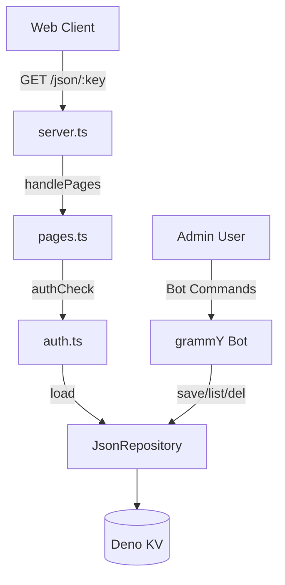

# Requirements

### Overview & Goals
The goal is to provide a way to host multiple arbitrary JSON contents on specific paths of the bot's server. These JSONs should be manageable (upload, edit, list, delete) via Telegram bot commands by administrators. The JSONs will be accessible via HTTP `GET` requests protected by Basic Auth. A new "pages" middleware system will be introduced to handle these HTTP requests.

### Scope
- **In Scope**:
  - `JsonRepository` for storing multiple JSON objects in Deno KV.
  - HTTP `GET /json/:key` endpoint returning the stored JSON.
  - Basic Auth protection for the JSON download endpoint.
  - A "pages" middleware for the HTTP server to handle GET requests using `URLPattern`.
  - Bot commands: `/json_store` with context-aware arguments (list, get, set, delete).
  - Support for custom names or generated UUIDs as keys.
- **Out of Scope**:
  - UI for editing JSON beyond bot commands.
  - Versioning of JSON files.
  - Public (unauthenticated) access to JSON files.

# Technical Design

### Current Implementation
- The project is a Deno-based Telegram bot using `grammy`.
- The server entry point is `server.ts`, which uses `Deno.serve`.
- Persistence is managed by `Deno.Kv` wrapped in `DenoStore`.

### Proposed Changes
1.  **Configuration**: Add `BASIC_AUTH_USER` and `BASIC_AUTH_PASSWORD` to `Config` interface and `initConfig` logic.
2.  **Storage Layer**:
    *   Add `delete(key: Deno.KvKey): Promise<boolean>` to `DenoStore`.
    *   Implement `JsonRepository` in `src/repository/json.repository.ts` using the prefix `['hosted_json']`.
3.  **HTTP Server ("Pages" Middleware)**:
    *   Create `src/server/pages.ts` as a registry for handlers using `URLPattern`.
    *   Add `unauthorized(realm: string)` and `notFound()` to `ServerResponse`.
    *   Implement Basic Auth in `src/server/auth.ts` to wrap handlers.
    *   Create `src/server/json-page.ts` for the `/json/:key` endpoint.
    *   Update `server.ts` to call `handlePages(req)` if `handleWebhook(req)` returns no response.
4.  **Bot Interface**:
    *   Implement `src/middleware/routes/json.ts` with the `/json_store` command.
    *   **Logic for `/json_store`**:
        - No arguments: List all stored JSON keys with their URLs.
        - `del <name>`: Delete the JSON with the given name.
        - `<name>` (existing): Display the JSON content and its public URL.
        - `<json_string>`: Save as a new entry with a generated UUID.
        - `<name> <json_string>`: Save or update the JSON entry with the given name.
        - Supports document uploads: If a file is attached, use its content as the JSON string.
    *   Register the new route in `src/middleware/index.ts`.

### Data Models / Contracts
**Storage Key**: `['hosted_json', key]` where `key` is the name or UUID.

**Basic Auth**: 401 response with `WWW-Authenticate: Basic realm="..."` if missing or invalid.

### Architecture Diagram

### File Structure
- `src/repository/json.repository.ts`: Persistence logic.
- `src/server/pages.ts`: HTTP request routing system.
- `src/server/auth.ts`: Basic Auth middleware for HTTP.
- `src/server/json-page.ts`: The JSON serving logic.
- `src/middleware/routes/json.ts`: Bot commands for JSON management.

# Testing

### Validation Approach
I will verify the functionality through unit tests for the repository and server logic, and manual end-to-end verification via the bot and curl.

### Key Scenarios
1.  **JSON Management via `/json_store`**:
    - `/json_store`: List all entries.
    - `/json_store {"a": 1}`: Create new with UUID.
    - `/json_store mydata {"a": 2}`: Create or update "mydata".
    - `/json_store mydata`: Show content and URL of "mydata".
    - `/json_store del mydata`: Delete "mydata".
2.  **Secure Access**: Access `/json/:key` via curl with and without Basic Auth.
3.  **Dynamic Routing**: Verify that the "pages" system correctly matches `/json/:key` and passes the key to the handler.

# Delivery Steps

###   Step 1: Storage Layer and Configuration
Update configuration and storage to support JSON management.

- Add `BASIC_AUTH_USER` and `BASIC_AUTH_PASSWORD` to `src/config.ts`.
- Add `delete` method to `DenoStore` in `src/store/denostore.ts`.
- Implement `JsonRepository` in `src/repository/json.repository.ts` with CRUD methods.
- Add tests in `src/repository/json.repository.test.ts`.

###   Step 2: HTTP Pages Middleware and Auth
Implement the infrastructure for serving web pages.

- Update `src/server/response.ts` with `unauthorized` and `notFound` helpers.
- Implement `src/server/pages.ts` for `URLPattern`-based routing.
- Implement `src/server/auth.ts` for Basic Auth logic.
- Integrate `handlePages` into `server.ts`.
- Add tests in `src/server/pages.test.ts`.

###   Step 3: JSON Serving Endpoint
Implement the endpoint to download stored JSON files.

- Create `src/server/json-page.ts` to register the `/json/:key` endpoint.
- Protect the endpoint using `basicAuth`.
- Add tests in `src/server/json-page.test.ts`.

###   Step 4: Bot Command for JSON Management
Add the Telegram interface for managing hosted JSON files.

- Create `src/middleware/routes/json.ts` with the `/json_store` command.
- Implement context-aware argument parsing:
    - Handle empty arguments (list).
    - Handle `del <key>` (delete).
    - Handle `<key>` (get/info).
    - Handle `<json>` or `<key> <json>` (set/update).
- Support document uploads to provide JSON content.
- Register the route in `src/middleware/index.ts`.
- Add tests for command logic in `src/middleware/routes/json.test.ts`.
